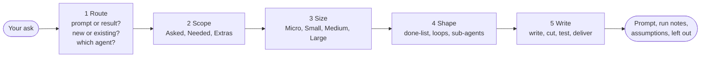

# Prompt Forge

**Version 1.1** · a skill for Claude

Prompt Forge turns a rough idea into a prompt that an autonomous AI agent can run well. You say
what you want built, researched, designed or automated. It gives you a prompt to paste into Claude
Code, Cursor, Codex or a Claude chat. The prompt is sized to the task, makes the agent prove its
result, and uses sub-agents and loops only where they pay off.

The whole skill is one file: [`skill/prompt-forge/SKILL.md`](skill/prompt-forge/SKILL.md).
Everything else in this repository explains how to use it, why it is built the way it is, and how
to change it safely.

## Who this repository is for

| You are | Start here |
|---|---|
| Using the skill | [Install it](docs/INSTALL.md), then read the [usage guide](docs/USAGE.md) and the [examples](examples/README.md) |
| A colleague who wants to change it | [CONTRIBUTING.md](CONTRIBUTING.md), then [docs/MAINTAINING.md](docs/MAINTAINING.md) |
| A future Claude session working on it | [CLAUDE.md](CLAUDE.md), then [docs/DESIGN.md](docs/DESIGN.md) and [docs/MAINTAINING.md](docs/MAINTAINING.md) |
| Curious why it works this way | [docs/DESIGN.md](docs/DESIGN.md) and [docs/BUILD-HISTORY.md](docs/BUILD-HISTORY.md) |

## Quick start

1. Install the skill. It takes about two minutes: see [docs/INSTALL.md](docs/INSTALL.md).
2. Ask for a prompt. Any of these work, typed or dictated:

   ```text
   Prompt forge: a prompt for Claude Code to build a script that renames my photos by date.
   Write me a hands-off prompt to map every supplier of CNC tooling in my city.
   Turn this idea into a prompt: a home maintenance tracker with reminders.
   This prompt made the agent build far too much. Fix it: [paste the prompt]
   ```

3. You get four things back, in this order:
   - one line saying what the prompt produces and how big it is;
   - the prompt, in a block you can copy;
   - short run notes: where to paste it, any command worth typing, any cost to expect;
   - the assumptions it made, and the extras it left out and can add on request.
4. Paste the prompt into your agent as the first message of a fresh session.

## What it does

| Feature | What it means for you | Guide |
|---|---|---|
| Right-sizing | Four sizes, from a 100-word paragraph to a full specification. It picks the smallest that fits. | [Sizes](docs/USAGE.md#4-sizes) |
| Scope ledger | Only what you asked for, plus what is needed to prove it, goes into the prompt. Other ideas are offered in a line each. | [The scope ledger](docs/USAGE.md#5-the-scope-ledger-and-left-out) |
| Done-lists | Every prompt ends in checks the agent has to run and show, so "done" is not a claim. | [The done-list](docs/USAGE.md#7-the-done-list) |
| Loops | Six kinds of loop, each with a check, an exit, a cap and a place for state. Used only when one pass is not enough. | [Loops](docs/USAGE.md#8-loops) |
| Sub-agents | A test for when delegation pays off, a six-part delegation block, and a "work directly" line for small jobs. | [Sub-agents](docs/USAGE.md#9-sub-agents) |
| Any kind of task | Software, research and sourcing, design and CAD, documents and skills, data, recurring jobs. | [Task types](docs/USAGE.md#11-task-types-beyond-software) |
| Any agent | Wording that works anywhere, with optional commands for Claude Code such as `/goal`. | [Which agent](docs/USAGE.md#10-which-agent) |
| Prompt repair | Give it a prompt that misbehaved and it returns the smallest fix. | [Fixing a prompt](docs/USAGE.md#13-fixing-a-prompt-that-misbehaved) |
| Prompt or result | If you ask for the thing itself, it asks once whether you want a prompt or the work done here. | [Prompt or result](docs/USAGE.md#3-prompt-or-result) |
| Self-test | It reads its own draft as the receiving agent would, and for big prompts hands that read to a fresh sub-agent. | [How it works](#how-it-works) |

## How it works

The skill works in five steps.



One idea sits behind all five: **current agents do what the prompt says, all of it.** A prompt
that lists ten deliverables gets ten deliverables. So the skill aims for the smallest prompt that
still gets the result proven. The reasoning is set out in [docs/DESIGN.md](docs/DESIGN.md).

## The four sizes

| Size | Fits | Instruction words | Checks |
|---|---|---|---|
| Micro | one artifact you can check at a glance | up to 150 | 1–2 |
| Small | one deliverable with a few parts or rules | 150–350 | 2–4 |
| Medium | a real app, tool or service; a multi-source report; a multi-part design | 350–800 | 4–7 |
| Large | multi-service systems, migrations, long unattended runs, sweeps over many items | 800–1,600 | 6–10 |

The numbers are ceilings, not targets, and data you supply does not count towards them.

## What a result looks like

For the ask "a script that renames my photos by the date taken, with a preview before it touches
anything", the whole prompt is one paragraph:

```text
Write a Python 3 script, rename_photos.py, that renames every .jpg and .heic in a folder I
pass as an argument to YYYY-MM-DD_HHMMSS.ext, using the photo's EXIF capture time and falling
back to the file's modified time. If two photos share a second, add -1, -2. Print each old →
new name, and only print when I pass --dry-run. Standard library plus Pillow; one file; no
config file, GUI or logging framework. When it's written, make a temp folder with five sample
images, run it with --dry-run and then for real, and show me both outputs.
```

Bigger asks get headed sections, a done-list, and loop and delegation blocks where they are
needed. The [examples](examples/README.md) show four complete results with the reasoning behind
each, including one request run through both version 1.0 and version 1.1.

## Repository map

| Path | What is in it |
|---|---|
| [`skill/prompt-forge/SKILL.md`](skill/prompt-forge/SKILL.md) | The skill. This is the only file Claude needs. |
| [`docs/INSTALL.md`](docs/INSTALL.md) | Installing and updating in the Claude apps and in Claude Code |
| [`docs/USAGE.md`](docs/USAGE.md) | Every feature and how to use it |
| [`docs/DESIGN.md`](docs/DESIGN.md) | Why each rule exists, the alternatives that were rejected, the known limits |
| [`docs/BUILD-HISTORY.md`](docs/BUILD-HISTORY.md) | How version 1.1 was built, step by step, and what was and was not tested |
| [`docs/MAINTAINING.md`](docs/MAINTAINING.md) | How to change the skill, test it and release a version |
| [`docs/SOURCES.md`](docs/SOURCES.md) | The documentation the design relies on, with the date each page was checked |
| [`examples/`](examples/README.md) | Four asks with the full prompts and the reasoning |
| [`tests/`](tests) | Checks for the skill file, the examples and the links |
| [`tools/`](tools) | The script that builds the installable zip |
| [`archive/v1.0/`](archive/v1.0/README.md) | The previous version, kept for comparison |
| [`CHANGELOG.md`](CHANGELOG.md) | What changed in each version |
| [`CLAUDE.md`](CLAUDE.md) | Short working notes for Claude sessions in this repository |

## Status and limits

- Version 1.1 was released on 21 November 2026.
- It was checked with the scripts in [`tests/`](tests) and with four dry runs written by following
  the skill by hand. It has not yet been evaluated by independent agent runs, and the prompts it
  forges have not yet been executed end to end by a coding agent. The details are in
  [docs/BUILD-HISTORY.md](docs/BUILD-HISTORY.md#what-was-not-done).
- The notes about specific agents and commands were checked in November 2026. Those products change
  quickly; [docs/MAINTAINING.md](docs/MAINTAINING.md#refreshing-the-agent-notes) says how to refresh
  them.

## Versions

| Version | Date | Summary |
|---|---|---|
| 1.1 | 21 November 2026 | Right-sizing, the scope ledger, loops, sub-agents, all task types, prompt repair, one self-contained file |
| 1.0 | 2026 | The original: software build prompts with a fixed, heavy structure. Archived in [`archive/v1.0/`](archive/v1.0/README.md). |

The full list of changes is in [CHANGELOG.md](CHANGELOG.md).

## License

This is a private project and no license has been granted. Choose one before making the repository
public.
